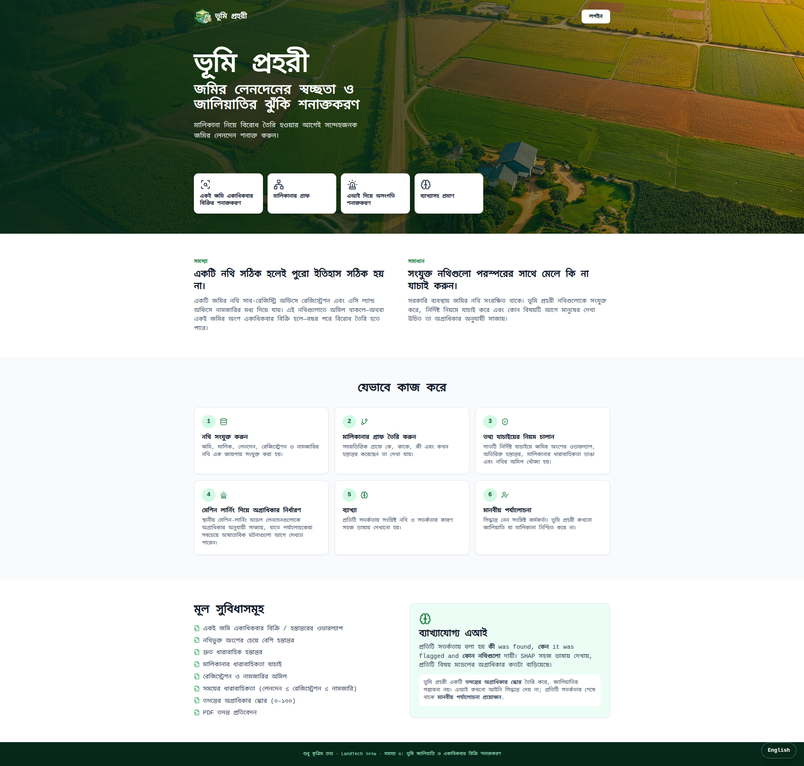

# ভূমি প্রহরী | LandGuard

**বাংলাদেশের জমির নথি যাচাই ও লেনদেনের অসংগতি শনাক্ত করার সিদ্ধান্ত-সহায়ক ব্যবস্থা**  
**A decision-support system for checking land records and identifying transaction inconsistencies in Bangladesh**

**LandTech 2026 Hackathon · Digital Land Records, Verification & Digitization · Problem P3**

ভূমি প্রহরী জমি, মালিক, লেনদেন, রেজিস্ট্রেশন ও নামজারির নথি একসঙ্গে বিশ্লেষণ করে। নিয়মভিত্তিক যাচাই, মেশিন লার্নিং এবং ব্যাখ্যাযোগ্য প্রমাণের সাহায্যে কোন লেনদেন আগে মানুষের পর্যালোচনা করা দরকার, তা অগ্রাধিকার অনুযায়ী দেখায়। ওয়েবসাইট ও ডাউনলোডযোগ্য PDF প্রতিবেদন বাংলা ও ইংরেজি—দুই ভাষায় ব্যবহার করা যায়।

LandGuard analyzes parcel, owner, transaction, registration, and mutation records together. Deterministic checks, machine learning, and explainable evidence help prioritize transactions for human review. The website and downloadable PDF reports are available in Bengali and English.

> **আইনি সীমা:** ভূমি প্রহরী কেবল সিদ্ধান্ত গ্রহণে সহায়তা করে। এটি জালিয়াতি প্রমাণিত বলে ঘোষণা করে না, আইনি মালিকানা নির্ধারণ করে না এবং কোনো ব্যক্তির বিরুদ্ধে আইনি সিদ্ধান্ত দেয় না। ০–১০০ স্কোরটি **তদন্তের অগ্রাধিকার স্কোর**, জালিয়াতির সম্ভাবনা নয়। প্রতিটি সতর্কতায় মানুষের পর্যালোচনা প্রয়োজন।
>
> **Legal boundary:** LandGuard is decision-support software. It does not determine legal ownership, confirm fraud, or make legal findings about a person. Its 0–100 score is an **Investigation Priority Score**, not a fraud probability. Every alert requires human review.

---

## সূচিপত্র | Contents

- [বাংলা](#বাংলা)
- [English](#english)

---

## বাংলা

### কীভাবে কাজ করে

নথিগুলোকে সংযুক্ত করে মালিকানা ও লেনদেনের ধারাবাহিকতা যাচাই করা হয়:

`নথি → মালিকানা-গ্রাফ → নিয়মভিত্তিক যাচাই → মেশিন লার্নিং → ব্যাখ্যাসহ প্রমাণ → মানবীয় পর্যালোচনা`

### প্রধান সুবিধা

- জেলা, উপজেলা, মৌজা, খতিয়ান, দাগ বা জমির আইডি দিয়ে জমি খোঁজা
- জমির সংক্ষিপ্ত বিবরণ, নথির ছবি, মালিকানার ইতিহাস, লেনদেনের গ্রাফ ও সময়রেখা দেখা
- একই অংশ একাধিকবার হস্তান্তর, অতিরিক্ত হস্তান্তর, দ্রুত হস্তান্তর, মালিকানার ধারাবাহিকতা ভঙ্গ এবং রেজিস্ট্রেশন/নামজারির অমিল শনাক্ত করা
- প্রতিটি সতর্কতার কারণ, সংশ্লিষ্ট নথি ও তুলনার ফল দেখা
- তদন্তের অগ্রাধিকার স্কোর এবং ব্যাখ্যাযোগ্য এআই বিশ্লেষণ দেখা
- PDF, JPG, JPEG ও PNG দলিল থেকে তথ্য শনাক্ত করে ফর্মে আনা, প্রয়োজনে সংশোধন করা এবং বিদ্যমান LandGuard রেকর্ডের সঙ্গে তুলনা করা
- দলিল যাচাই, বিশ্লেষণ ড্যাশবোর্ড ও সাইডবার বাংলা/ইংরেজি ভাষা সেটিং অনুসারে ব্যবহার করা
- বাংলা বা ইংরেজিতে ওয়েবসাইট ব্যবহার ও PDF প্রতিবেদন ডাউনলোড করা

দলিলের তথ্য শনাক্তকরণ কেবল পর্যালোচনার সহায়তা। শনাক্ত করা তথ্য ব্যবহারকারীকে যাচাই ও প্রয়োজনে সংশোধন করতে হবে। ফলাফল কোনো আইনি সিদ্ধান্ত বা মালিকানা/জালিয়াতির নিশ্চয়তা নয়।

### প্রযুক্তি

| অংশ | প্রযুক্তি |
|---|---|
| ওয়েব অ্যাপ | React, Vite, Tailwind CSS, React Router, Recharts, React Flow |
| API | Python, FastAPI, SQLAlchemy |
| ডেটা ও বিশ্লেষণ | SQLite, pandas, NumPy, scikit-learn, XGBoost, SHAP, NetworkX |
| PDF প্রতিবেদন | ReportLab |

### প্রকল্পের কাঠামো

```text
backend/
  app/              API, ডেটাবেস, নিয়মভিত্তিক বিশ্লেষণ, প্রতিবেদন
  data/raw/         কৃত্রিম CSV ডেটাসেট
  ml/               ফিচার তৈরি, মডেল প্রশিক্ষণ ও মূল্যায়ন
  scripts/          ডেটা যাচাই, আমদানি ও বিশ্লেষণ চালানোর স্ক্রিপ্ট
  requirements.txt
frontend/
  src/              React অ্যাপ, পেজ, উপাদান ও ভাষা ব্যবস্থাপনা
  package.json
docs/               পদ্ধতি, ডেমো ও প্রকল্পের নথি
setup.sh            প্রাথমিক সেটআপ
run_backend.sh      API সার্ভার চালু করে
run_frontend.sh     ওয়েব অ্যাপ চালু করে
```

### প্রয়োজনীয়তা

- Ubuntu বা সমমানের Linux পরিবেশ
- Python 3.11 বা পরবর্তী সংস্করণ
- Node.js LTS ও npm
- Git

দলিল যাচাইয়ের স্ক্যান/OCR সুবিধার জন্য Tesseract OCR এবং বাংলা ভাষার ডেটা (`tesseract-ocr`, `tesseract-ocr-ben`) ইনস্টল থাকতে হবে। Python নির্ভরতাগুলো `backend/requirements.txt`-এ আছে। OCR নির্ভরতা না থাকলে ডিজিটাল PDF-এর পাঠ্য বের করা যাবে, তবে স্ক্যান করা ছবি/PDF থেকে OCR করা যাবে না।

Docker, বহিরাগত এআই API বা চলমান ইন্টারনেট সংযোগ লাগে না; তবে প্রথম সেটআপে Python ও npm নির্ভরতাগুলো ইনস্টল করতে হবে।

### ইনস্টল ও চালু করা

প্রকল্পের মূল ফোল্ডার থেকে একবার চালান:

```bash
./setup.sh
```

স্ক্রিপ্টটি Python ভার্চুয়াল এনভায়রনমেন্ট তৈরি করে, নির্ভরতা ইনস্টল করে, ডেটা যাচাই ও SQLite-এ আমদানি করে, মেশিন-লার্নিং মডেল প্রশিক্ষণ দেয়, বিশ্লেষণ চালায় এবং ওয়েব নির্ভরতা ইনস্টল করে।

এরপর আলাদা দুটি টার্মিনালে চালান:

```bash
# টার্মিনাল ১: ব্যাকএন্ড API — http://localhost:8000
./run_backend.sh
```

```bash
# টার্মিনাল ২: ওয়েব অ্যাপ — http://localhost:5173
./run_frontend.sh
```

API-এর ইন্টারেক্টিভ ডকুমেন্টেশন: [http://localhost:8000/docs](http://localhost:8000/docs)।

### ডেটাসেট

প্রকল্পে ব্যবহৃত ডেটা সম্পূর্ণ কৃত্রিম; এতে বাস্তব ব্যক্তির নাম, জাতীয় পরিচয়পত্র, ফোন নম্বর বা সরকারি জমির নথি নেই।

| ফাইল | সারি | প্রধান আইডি |
|---|---:|---|
| `parcels.csv` | ১৫,০০০ | `parcel_id` |
| `owners.csv` | ১১,৫০০ | `owner_id` |
| `transactions.csv` | ২৫,০০০ | `transaction_id` |
| `registrations.csv` | ২৩,৩৭০ | `registration_id` |
| `mutations.csv` | ২০,৬৩২ | `mutation_id` |
| `fraud_labels.csv` | ২৫,০০০ | `transaction_id` |

ডেটার কলাম ও সম্পর্কের বিস্তারিত: [`docs/METHODOLOGY.md`](docs/METHODOLOGY.md)।

### শনাক্তকরণ নিয়ম

| সংকেত | নিয়মের সারাংশ |
|---|---|
| একই অংশ একাধিকবার হস্তান্তর | আগের লেনদেনে বিক্রেতার সম্পূর্ণ অংশ হস্তান্তরের পরও একই জমিতে তাঁকে আবার বিক্রেতা হিসেবে দেখা যায়। স্বাভাবিক ধারাবাহিক হস্তান্তরকে এ কারণে চিহ্নিত করা হয় না। |
| অতিরিক্ত হস্তান্তর | হস্তান্তরিত অংশ বিক্রেতার নথিভুক্ত অংশের চেয়ে বেশি, অথবা হস্তান্তরিত জমি তাঁর নিয়ন্ত্রণাধীন জমির চেয়ে বেশি। |
| দ্রুত হস্তান্তর | আগের হস্তান্তরের ৭ দিনের মধ্যে জোরালো, ৮–৩০ দিনের মধ্যে মাঝারি সংকেত। সীমা `backend/app/config.py`-এ নির্ধারিত। |
| মালিকানার ধারাবাহিকতা ভঙ্গ | নথিভুক্ত বিক্রেতা ও নথিভুক্ত আগের মালিকের তথ্য মেলে না। |
| রেজিস্ট্রেশনের অমিল | রেজিস্ট্রেশন নথি নেই, অথবা ক্রেতা/বিক্রেতা/জমির পরিমাণ/ধরন লেনদেনের সঙ্গে মেলে না; কিংবা রেজিস্ট্রেশনের তারিখ লেনদেনের আগের। |
| নামজারির অমিল | নামজারির নথি নেই, অথবা মালিক/জমির পরিমাণ/অংশ/ধরন রেজিস্ট্রেশনের সঙ্গে মেলে না; কিংবা নামজারির তারিখ রেজিস্ট্রেশন বা লেনদেনের আগের। |
| তারিখের অসংগতি | প্রত্যাশিত ক্রম `লেনদেন ≤ রেজিস্ট্রেশন ≤ নামজারি` বজায় নেই। |

এসব নিয়ম সম্ভাব্য অসংগতি চিহ্নিত করে; এগুলো নিজে থেকে কোনো অনিয়ম বা অপরাধের প্রমাণ নয়।

### মেশিন লার্নিং ও স্কোর

প্রশিক্ষণ প্রক্রিয়ায় ফিচার তৈরি, স্তরভিত্তিক ৮০/২০ বিভাজন, Random Forest ও XGBoost মডেল প্রশিক্ষণ, মূল্যায়ন এবং SHAP ব্যাখ্যা রয়েছে। `pattern` ফিচার ইতিহাস, সময় ও জমির পরিমাণ ব্যবহার করে; `records` ফিচার নথির তুলনাও যোগ করে এবং ব্যবহৃত মডেল সেট; `full` সেটে নিয়মের সংকেতও থাকে, তাই এটি ডেটা-লিকেজ বোঝানোর জন্য। লেবেল, নিয়মের সংকেত, স্কোর বা পূর্বাভাস মডেল ইনপুট হিসেবে ব্যবহার করা হয় না। সংরক্ষিত স্কোরগুলো ৫-ভাঁজ out-of-fold পূর্বাভাস।

অগ্রাধিকার স্কোরের সূত্র:

```text
min(৭০, নিয়মের ওজনের যোগফল) + ৩০ × মেশিন-লার্নিং স্কোর
```

| স্কোর | স্তর |
|---:|---|
| ০–২৯ | নিম্ন |
| ৩০–৫৯ | মাঝারি |
| ৬০–৭৯ | উচ্চ |
| ৮০–১০০ | গুরুতর |

**মূল্যায়নের সীমা:** `fraud_labels.csv`-এর কৃত্রিম লেবেলগুলো একই ধরনের নিয়ম থেকে তৈরি। ফলে নিয়মগুলো লেবেলের সঙ্গে খুব বেশি মেলে, আর `full` ফিচার সেটে নিয়মের সংকেত থাকায় ফল ১০০% হতে পারে। এটি বাস্তব জালিয়াতি শনাক্ত করার সক্ষমতার প্রমাণ নয়। শুধু `pattern` ফিচার দিয়ে XGBoost-এর F1 প্রায় ৮২%; এই কৃত্রিম ডেটায় নিয়মভিত্তিক মডেলিংকে বাস্তব ডেটায় পুনরায় মূল্যায়ন করতে হবে। বিস্তারিত: [`docs/METHODOLOGY.md`](docs/METHODOLOGY.md)।

পরীক্ষার বিভাজনে লেবেলযুক্ত লেনদেনের ৪১.৪% ইতিবাচক ছিল:

| পদ্ধতি | নির্ভুলতা | শনাক্তকরণ হার | F1 |
|---|---:|---:|---:|
| শুধু নিয়ম | ৯৫.৩% | ১০০.০% | ৯৭.৬% |
| শুধু XGBoost (`pattern`) | ৯৪.২% | ৭২.৫% | ৮১.৯% |
| নিয়ম ও XGBoost (`records`) | ৯৪.৬% | ১০০.০% | ৯৭.২% |

### API

সব API পথ `/api` দিয়ে শুরু হয়। প্রধান এন্ডপয়েন্ট:

- `GET /api/health`, `GET /api/demo`, `GET /api/meta/locations`
- `GET /api/dashboard/stats`, `GET /api/analytics`, `GET /api/model/metrics`
- `GET /api/parcels`, `GET /api/parcels/{parcel_id}`
- `GET /api/parcels/{parcel_id}/history`, `/timeline`, `/graph`, `/alerts`
- `GET /api/transactions`, `GET /api/transactions/{transaction_id}`
- `GET /api/alerts`, `GET /api/alerts/{transaction_id}`
- `GET /api/investigations/{transaction_id}`, `POST /api/investigate/{transaction_id}`
- `GET /api/registration-mutation/{transaction_id}`
- `POST /api/document/extract` — PDF/image থেকে যাচাইযোগ্য তথ্য শনাক্ত করে (সর্বোচ্চ ১৫ MB)
- `POST /api/document/verify` — পাঠানো দলিলের তথ্য বিদ্যমান LandGuard জমির রেকর্ডের সঙ্গে তুলনা করে
- `GET /api/reports/{transaction_id}?lang=bn` — বাংলা PDF; `lang=en` দিলে ইংরেজি PDF
- `GET /api/owners/{owner_id}`, `GET /api/owners/{owner_id}/history`
- `GET /api/ownership/history?parcel_id={parcel_id}` অথবা `?owner_id={owner_id}`
- `GET /api/registrations/{registration_id}`, `GET /api/mutations/{mutation_id}`

### ডেমো ও অতিরিক্ত নথি

- তিন মিনিটের ডেমো নির্দেশনা: [`docs/DEMO_SCRIPT.md`](docs/DEMO_SCRIPT.md)
- পদ্ধতি ও ডেটাসেট: [`docs/METHODOLOGY.md`](docs/METHODOLOGY.md)
- প্রথম ধাপের যাচাইতালিকা: [`docs/PHASE1_CHECKLIST.md`](docs/PHASE1_CHECKLIST.md)

### সীমাবদ্ধতা

- ডেটা ও লেবেল কৃত্রিম; বাস্তব সরকারি নথি বা বাস্তব ঘটনার ওপর ফল যাচাই করা হয়নি।
- অস্বাভাবিকতার সংকেত তদন্তের অগ্রাধিকার নির্ধারণে সহায়তা করে; আইনি সিদ্ধান্ত দেয় না।
- মালিকানার ধারাবাহিকতা নথিভুক্ত `previous_owner_id`-এর ওপর নির্ভরশীল।
- বাতিল লেনদেনসহ সব অবস্থার লেনদেনে রেজিস্ট্রেশন/নামজারির অনুপস্থিতিও সংকেত হিসেবে ধরা হতে পারে।
- জমির চিত্রটি উদাহরণমূলক; এটি GIS বা সরকারি জরিপের মানচিত্র নয়।
- ব্যবহারকারী লগইন, ভূমিকা-ভিত্তিক অনুমতি ও নিরীক্ষা-লগ এখনো অন্তর্ভুক্ত নয়।

---

## English

### How it works

LandGuard links records to examine ownership and transaction continuity:

`Records → Ownership graph → Deterministic checks → Machine learning → Explainable evidence → Human review`

### Features

- Search by district, upazila, mouza, khatian, dag, or parcel ID
- View parcel summaries, document images, ownership history, transaction graphs, and timelines
- Detect overlapping transfers, over-transfers, rapid transfers, ownership-chain breaks, and registration/mutation mismatches
- Review the evidence and linked records behind each alert
- View Investigation Priority Scores and explainable AI analysis
- Extract fields from PDF, JPG, JPEG, and PNG documents, review or edit them, and compare them with existing LandGuard records
- Use document verification, the analytics dashboard, and navigation in Bengali or English
- Use the website and download PDF reports in Bengali or English

Document extraction is provided for review support. Users should verify and correct extracted values where needed. Results are not legal findings and do not establish ownership or fraud.

### Technology

| Area | Technology |
|---|---|
| Web app | React, Vite, Tailwind CSS, React Router, Recharts, React Flow |
| API | Python, FastAPI, SQLAlchemy |
| Data and analysis | SQLite, pandas, NumPy, scikit-learn, XGBoost, SHAP, NetworkX |
| PDF reports | ReportLab |

### Requirements

- Ubuntu or a similar Linux environment
- Python 3.11 or newer
- Node.js LTS and npm
- Git

Scanned document OCR requires the system Tesseract binary and Bengali language data (`tesseract-ocr` and `tesseract-ocr-ben`). Python packages are listed in `backend/requirements.txt`. Digital PDF text extraction can work without Tesseract; scanned image/PDF OCR cannot.

No Docker, external AI API, or ongoing internet connection is required. Internet access is needed during initial dependency installation.

### Install and run

From the project root, run the setup script once:

```bash
./setup.sh
```

The script creates a Python virtual environment, installs dependencies, validates and imports the datasets into SQLite, trains the ML models, runs the analysis, and installs the frontend dependencies.

Then start the backend and frontend in separate terminals:

```bash
# Terminal 1: backend API at http://localhost:8000
./run_backend.sh
```

```bash
# Terminal 2: web app at http://localhost:5173
./run_frontend.sh
```

Interactive API documentation: [http://localhost:8000/docs](http://localhost:8000/docs).

### Dataset

All project data is synthetic. It contains no real names, national ID numbers, phone numbers, or government land records.

| File | Rows | Primary ID |
|---|---:|---|
| `parcels.csv` | 15,000 | `parcel_id` |
| `owners.csv` | 11,500 | `owner_id` |
| `transactions.csv` | 25,000 | `transaction_id` |
| `registrations.csv` | 23,370 | `registration_id` |
| `mutations.csv` | 20,632 | `mutation_id` |
| `fraud_labels.csv` | 25,000 | `transaction_id` |

See [`docs/METHODOLOGY.md`](docs/METHODOLOGY.md) for columns and relationships.

### Detection rules

| Signal | Rule summary |
|---|---|
| Overlapping transfer | A seller appears again on the same parcel after an earlier transaction transferred their entire interest. A normal ownership chain is not flagged for this reason. |
| Over-transfer | The transferred share exceeds the seller’s recorded share, or the transferred area exceeds the area they controlled. |
| Rapid transfer | Strong signal within 7 days; moderate signal within 8–30 days. Thresholds are configurable in `backend/app/config.py`. |
| Ownership-chain break | The recorded seller differs from the recorded previous owner. |
| Registration mismatch | Registration is missing or its buyer, seller, area, or type differs from the transaction; the registration date may also precede the transaction date. |
| Mutation mismatch | Mutation is missing or its owner, area, share, or type differs from registration; the mutation date may also precede the registration or transaction date. |
| Temporal inconsistency | The expected order `transaction ≤ registration ≤ mutation` is not maintained. |

These rules flag potential inconsistencies for review; they do not establish wrongdoing or legal facts.

### Machine learning and scoring

The pipeline builds features, uses a stratified 80/20 split, trains Random Forest and XGBoost models, evaluates them, and generates SHAP explanations. `pattern` features cover history, timing, and area; `records` adds record-comparison features and is the deployed feature set; `full` also contains rule signals and is included only to demonstrate leakage. Labels, rule signals, scores, and predictions are not used as model inputs. Stored scores are five-fold out-of-fold predictions.

The Investigation Priority Score is calculated as:

```text
min(70, sum of rule weights) + 30 × ML score
```

| Score | Level |
|---:|---|
| 0–29 | Low |
| 30–59 | Medium |
| 60–79 | High |
| 80–100 | Critical |

**Evaluation caveat:** The synthetic labels in `fraud_labels.csv` were derived from rules over the same records. Therefore, rule results closely match those labels, and the `full` feature set can reach 100% because it includes rule signals. This is not evidence of real-world fraud-detection performance. XGBoost with `pattern` features has an F1 score of about 82% on this synthetic dataset. Real data would require a new evaluation. See [`docs/METHODOLOGY.md`](docs/METHODOLOGY.md).

The held-out test split contained a 41.4% positive-label rate:

| Approach | Precision | Recall | F1 |
|---|---:|---:|---:|
| Rules only | 95.3% | 100.0% | 97.6% |
| XGBoost only (`pattern`) | 94.2% | 72.5% | 81.9% |
| Rules + XGBoost (`records`) | 94.6% | 100.0% | 97.2% |

### API

All API routes use the `/api` prefix. Main endpoints:

- `GET /api/health`, `GET /api/demo`, `GET /api/meta/locations`
- `GET /api/dashboard/stats`, `GET /api/analytics`, `GET /api/model/metrics`
- `GET /api/parcels`, `GET /api/parcels/{parcel_id}`
- `GET /api/parcels/{parcel_id}/history`, `/timeline`, `/graph`, `/alerts`
- `GET /api/transactions`, `GET /api/transactions/{transaction_id}`
- `GET /api/alerts`, `GET /api/alerts/{transaction_id}`
- `GET /api/investigations/{transaction_id}`, `POST /api/investigate/{transaction_id}`
- `GET /api/registration-mutation/{transaction_id}`
- `POST /api/document/extract` — extract reviewable fields from a PDF/image (15 MB maximum)
- `POST /api/document/verify` — compare submitted document fields with existing LandGuard parcel records
- `GET /api/reports/{transaction_id}?lang=en` — English PDF; use `lang=bn` for Bengali
- `GET /api/owners/{owner_id}`, `GET /api/owners/{owner_id}/history`
- `GET /api/ownership/history?parcel_id={parcel_id}` or `?owner_id={owner_id}`
- `GET /api/registrations/{registration_id}`, `GET /api/mutations/{mutation_id}`

### Demo and documentation

- Three-minute demo guide: [`docs/DEMO_SCRIPT.md`](docs/DEMO_SCRIPT.md)
- Methodology and dataset: [`docs/METHODOLOGY.md`](docs/METHODOLOGY.md)
- Phase 1 checklist: [`docs/PHASE1_CHECKLIST.md`](docs/PHASE1_CHECKLIST.md)

### Limitations

- Data and labels are synthetic; the results have not been validated against real government records or real incidents.
- Anomaly signals help prioritize investigation and do not make legal findings.
- Ownership continuity depends on the recorded `previous_owner_id` field.
- Missing registration or mutation records may be flagged across transaction statuses, including cancelled transactions.
- Parcel illustrations are illustrative and are not GIS or official survey maps.
- User authentication, role-based access, and audit logging are not included yet.

---

## Data, libraries, and AI disclosure

- **Data source:** Synthetic datasets created for the LandTech 2026 project. No real personal data was scraped or used.
- **Open-source libraries:** FastAPI, SQLAlchemy, pandas, NumPy, scikit-learn, XGBoost, SHAP, NetworkX, ReportLab, joblib, React, Vite, Tailwind CSS, React Router, Recharts, React Flow, and Lucide.
- **AI tools:** An AI coding assistant was used to help create and document parts of the project. The project team is responsible for reviewing and explaining the code. See [`docs/METHODOLOGY.md`](docs/METHODOLOGY.md).
